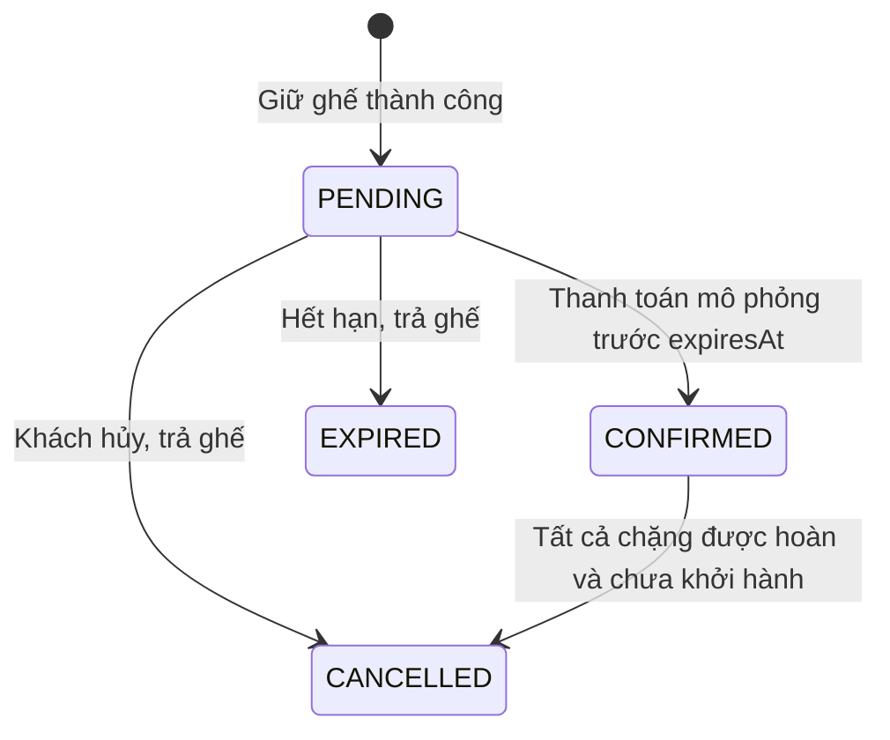

# Kiến trúc và quy tắc phát triển

## Công nghệ và môi trường

Giữ cùng mô hình monorepo và các phiên bản dependency đã khóa từ dự án nguồn. Backend dùng Express 4, TypeScript, Prisma 6, PostgreSQL 15, Redis 7/ioredis, Zod, bcryptjs, JWT, Helmet, CORS, cookie-parser và express-rate-limit. Frontend dùng React 18, Vite 6, TypeScript, React Router 6, Axios, Tailwind/PostCSS và CSS responsive. Không nâng dependency trong quá trình chuyển nghiệp vụ.

`routes` chọn middleware/controller. Controller xác thực đầu vào bằng Zod và định dạng response. Service xử lý nghiệp vụ. Repository chứa truy vấn và quan hệ dùng chung cho flights, bookings, users. Các truy vấn CRUD quản trị ngắn sử dụng Prisma trực tiếp; không ép thêm tầng chỉ để chuyển tiếp một lệnh. Một PrismaClient singleton cho mỗi process.

## Thuật toán chuyển từ Travel Platform

- Chuẩn hóa Unicode NFD, loại dấu kết hợp, chuyển đ/Đ sang d/D giúp tìm sân bay bằng tiếng Việt không dấu.
- Haversine giữ nguyên nền tảng toán học khoảng cách trên mặt cầu bán kính 6.371km, dùng để tạo thời lượng lịch bay demo. Không thay thế lịch bay xác nhận của hãng.
- Gợi ý chuyển từ xếp hạng địa điểm sang xếp hạng chuyến bay, chuẩn hóa giá và thời gian trong tập ứng viên. Điểm = 100 × `[w × (1 − giá/maxGiá) + (1−w) × (1 − thờiGian/maxThờiGian) + thưởngHãng + thưởngNgânSách]`. w = 0,8 khi ưu tiên giá; 0,2 khi ưu tiên thời gian; 0,5 khi cân bằng. Thưởng hãng 0,15; thưởng trong ngân sách 0,1. Điểm là chỉ số tương đối, có thể vượt 100, không phải xác suất.
- Tie-break theo giá và ID để kết quả ổn định. Truy vấn ngôn ngữ ngắn nhận diện nhu cầu tiết kiệm/nhanh; không tự suy đoán ngày bay, sân bay hoặc hành khách.
- Không sử dụng thuật toán tối ưu lịch trình tham quan vào định tuyến hàng không. Bản này tìm chuyến bay thẳng; khứ hồi là hai chuyến ngược chiều có thời gian hợp lệ.

## Giữ ghế và chống overselling

`POST /bookings`: xác thực fareIds, hành khách, chuyến mở bán và khởi hành sau ít nhất 1 giờ. Với khứ hồi, chuyến về phải đảo đúng cặp sân bay và khởi hành ít nhất 1 giờ sau giờ đến chuyến đi.

Trong transaction Serializable, giảm `available_seats` bằng `UPDATE ... WHERE available_seats >= passengerCount`. Nếu không cập nhật đủ chặng, toàn transaction rollback. Các fare được cập nhật theo ID tăng dần để giảm deadlock. Lỗi Prisma P2034 được thử lại tối đa 3 lần. Ràng buộc SQL chặn tồn âm hoặc lớn hơn sức chứa ngay cả khi ghi ngoài API.

Lưu snapshot giá, hạng, hành lý và quyền hoàn trên BookingSegment. Tổng tiền là số nguyên VND, kiểm tra giới hạn INT. Không nhận giá do frontend gửi lên. Idempotency key ràng buộc theo user và request hash; lặp đúng nội dung trả lại cùng đơn, dùng key cũ cho dữ liệu khác trả 409.

Worker mỗi 30 giây và các điểm vào booking chạy cleanup. Chỉ request thắng chuyển PENDING → EXPIRED mới được trả ghế. Không dựa vào TTL Redis để kiểm soát tồn ghế. PostgreSQL là nguồn dữ liệu chính.

## Máy trạng thái

Thanh toán dùng transaction kiểm tra quyền sở hữu và CAS trạng thái. Payment unique bookingId; Ticket unique passengerId/segmentId. Gửi lặp không phát hành thêm vé. Hủy vé đã thanh toán đánh dấu ticket VOID, payment REFUNDED và trả ghế một lần trong cùng transaction.

## Phiên đăng nhập

Access JWT sống 15 phút, lưu trong bộ nhớ trình duyệt. Refresh token opaque 48 byte, cookie HttpOnly/SameSite=Lax, Secure khi production; chỉ SHA-256 hash được lưu DB. Refresh consume một lần và xoay token, giữ hạn tuyệt đối 7 ngày. Refresh/login/register/logout kiểm tra Origin chính xác. JWT xác minh HS256, issuer, audience và tokenVersion. Mỗi request kiểm tra tài khoản còn hoạt động; đổi mật khẩu/quyền hoặc khóa tài khoản tăng tokenVersion và thu hồi refresh tokens.

API `/auth/me` và response người dùng dùng danh sách field công khai, không trả passwordHash. Link reset dùng 32 byte ngẫu nhiên, hash DB, hết hạn 15 phút, dùng một lần, gửi SMTP; reset thu hồi các phiên và reset tokens còn lại.

## Cache và ngày giờ

Danh mục sân bay cache Redis 30 giây, key có namespace `flight:`. CRUD sân bay xóa cache. Không cache tồn ghế hoặc giá tìm kiếm. Khi Redis lỗi, truy vấn DB trực tiếp.

Ngày tìm kiếm tính từ 00:00 UTC+07 đến 00:00 ngày kế tiếp; đây là quy ước của bản demo tập trung thị trường Việt Nam, kể cả tuyến quốc tế demo. DB lưu lịch bay bằng TIMESTAMPTZ. Giao diện giờ bay hiển thị theo timezone từng sân bay. Phần quản trị nhập giờ theo múi giờ máy tính và chuyển UTC khi lưu. Ngày sinh dùng DATE.

## Giới hạn vận hành

Giới hạn 500 chuyến/kết quả, 100 đơn/người dùng, 200 đơn/user/review trong admin. Đây là bản đồ án/local có phân trang phía client cho danh sách admin, chưa có phân trang server cho tải lớn. Khi triển khai thật cần pagination server, job queue, audit event, lưu trữ tài liệu hành khách phù hợp và adapter nhà cung cấp.
