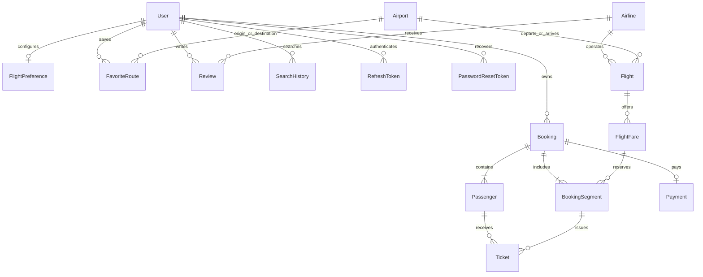

# Thiết kế database

PostgreSQL, bảng snake_case và cột map bằng Prisma, primary key INT cho catalog, UUID cho booking/payment/session/ticket, unique key và index theo mẫu Travel Platform. Migration đầu tạo bảng, migration thứ hai thêm CHECK constraints nghiệp vụ.

| Bảng | Nội dung | Ràng buộc chính |
| --- | --- | --- |
| users | Hồ sơ, bcrypt hash, role, tokenVersion | email unique, role USER/ADMIN |
| refresh_tokens | Hash refresh token, hạn tuyệt đối | tokenHash unique, index user/hạn |
| password_reset_tokens | Hash token khôi phục | tokenHash unique, index hạn |
| airlines | Mã hãng, tên, màu, hoạt động | code unique |
| airports | IATA, thành phố, quốc gia, timezone, tọa độ | code unique |
| flights | Lịch khai thác cụ thể và máy bay | unique flightNumber/departureTime, index route/day |
| flight_fares | Giá/hành lý/hoàn/tồn theo hạng | unique flightId/cabinClass, 0 ≤ available ≤ total |
| bookings | Chủ đơn, liên hệ, trạng thái, tổng tiền, expiresAt | reference unique, user/idempotencyKey unique |
| booking_segments | Từng chặng + snapshot giá và điều kiện | unique bookingId/sequence |
| passengers | Hành khách thuộc đơn | FK booking cascade |
| tickets | Một vé cho mỗi hành khách/chặng | number unique, passenger/segment unique |
| payments | Giao dịch mô phỏng của đơn | bookingId unique, transactionId unique |
| favorite_routes | Đường bay yêu thích | user/origin/destination unique |
| flight_preferences | Ngân sách/hạng/hãng/ưu tiên | userId là primary key 1–1 |
| reviews | Đánh giá hãng sau chuyến bay | user/airline unique, rating 1–5 |
| search_history | Yêu cầu gợi ý đã thực hiện | JSON query, index user/createdAt |

Không có quan hệ hoặc URL đến database của travel-platform. Docker dùng volume `flight-tickets-platform_flight_postgres_data`, database `flight_tickets_db`, host port 5434. Integration tests dùng schema `flight_platform_test`, production/local dùng `public`.

Seed tạo 9 sân bay, 3 hãng, 20 hướng bay (10 cặp đi/về), 3 chuyến/hướng/ngày, 35 ngày và 3 hạng/chuyến: 2.100 chuyến, 6.300 hạng vé nếu database mới. Không cập nhật hạng đã tồn tại để tránh đổi tồn khi đang có đơn. Chạy lại seed chỉ bổ sung lịch/hạng còn thiếu.

Sao lưu bằng `pg_dump` của database mới, giữ bí mật dữ liệu liên hệ và số giấy tờ. Không chép database hoặc `.env` của Travel Platform vào dự án này. Khi thay đổi mật khẩu PostgreSQL sau khi volume đã tạo, phải cập nhật role trong DB và backend URL tương ứng; đổi biến compose không tự đổi mật khẩu trong volume cũ.
